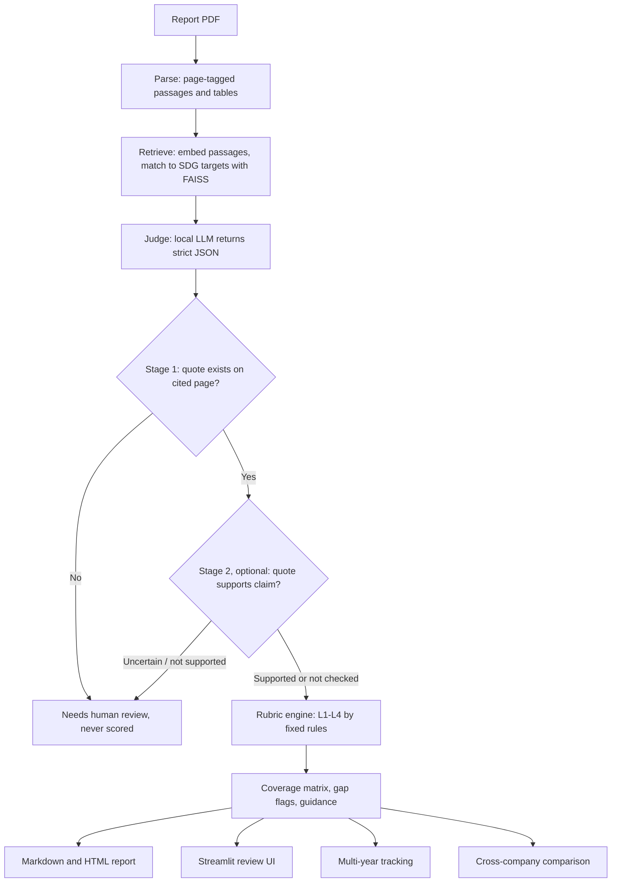

# Prism17: Evidence-Grounded SDG Disclosure Auditor

**FIRE 2026 | Sustainable Development Through AI (SDAI)**
Co-located with the FIRE 2026 Conference, Indian Statistical Institute, Kolkata
Event page: <https://sohampoddar26.github.io/fire26-sdai/session.html>

Prism17 reads a corporate report (BRSR filing, sustainability report or annual
report) and produces an **SDG Alignment Report**, in the style of a similarity
report attached to a document. It maps passages to the UN Sustainable Development
Goals and their targets, grades how concrete each commitment is, and ties every
finding to a **verified quote and page number**.

> Prism17 assesses **disclosure quality**, not real-world sustainability
> performance. It is decision support: a human reviewer confirms or overrides
> every finding before it is used.

---

## Contents
1. [Submission at a glance](#1-submission-at-a-glance)
2. [Problem](#2-problem)
3. [Solution](#3-solution)
4. [How the pipeline works](#4-how-the-pipeline-works)
5. [Open-source and local-only AI](#5-open-source-and-local-only-ai)
6. [SDGs addressed](#6-sdgs-addressed)
7. [Working prototype and measured results](#7-working-prototype-and-measured-results)
8. [Quick start](#8-quick-start)
9. [Project layout](#9-project-layout)
10. [Evaluation status](#10-evaluation-status)
11. [Limitations](#11-limitations)
12. [Responsible use](#12-responsible-use)
13. [AI assistance disclosure](#13-ai-assistance-disclosure)
14. [Team](#14-team)
15. [Licence and acknowledgements](#15-licence-and-acknowledgements)

---

## 1. Submission at a glance

| | |
|---|---|
| **Project** | Prism17 |
| **Event** | FIRE 2026, Sustainable Development Through AI (SDAI) session |
| **Tagline** | Every SDG finding traced to a verified quote |
| **Focus SDGs** | 8, 12, 13, 17 (all 17 goals and 169 targets are supported by the tool) |
| **Input** | A report PDF |
| **Output** | SDG Alignment Report (Markdown and HTML), audit JSON, Streamlit review UI |
| **Repository** | <https://github.com/HiXT0/Prism17> |
| **Proposal deck** | *[link to be added]* (up to 20 slides, PPT or PDF) |
| **Demo video** | *[link to be added]* |

**How this project meets the SDAI requirements**

| Requirement | How Prism17 meets it |
|---|---|
| All AI is open-source and free of cost | Ollama with open-weight models, BGE embeddings, FAISS and an open NLI model, all run locally. No paid or proprietary AI API is called. See [Section 5](#5-open-source-and-local-only-ai). |
| A usable working prototype exists at submission | The full pipeline, report generator and review UI run from this repository. See [Sections 7 and 8](#7-working-prototype-and-measured-results). |
| Usable, deployable system for a real sustainability challenge | Screens real BRSR and sustainability reports for how specific and verifiable their SDG disclosures are, on a laptop with no GPU. |
| Team of 1 to 5 including a full-time student | Two students and one faculty guide. See [Section 14](#14-team). |
| Proposal of up to 20 slides | Linked in the table above. |

## 2. Problem

Companies publish sustainability disclosures that run to hundreds of pages.
SDG-related claims are scattered across narrative text and data tables, vary
widely in specificity, and are hard to compare across companies or years. In
India, BRSR filings are mandatory for the top listed companies, yet they remain
difficult to screen at scale.

SDG text classifiers label passages with goals. They do not answer what
investors, regulators, journalists and NGOs actually ask:

- **How concrete is this commitment?** Is there a measurable indicator, a deadline,
  a baseline, reported progress?
- **Is the cited evidence real?** Does the quote exist on the page, and does it
  support the claim being made?
- **How did a target change** between reporting years?

Without verifiable evidence, readers either review reports by hand or trust
automated output they cannot check. This is an information retrieval problem as
much as a classification one: finding the right passage, citing it exactly, and
showing the reader where it came from.

## 3. Solution

Prism17 takes a report PDF and returns an auditable report.

1. **Verified evidence.** Every quote returned by the model is matched against
   the parsed source page. A quote that cannot be found is never scored. An
   optional second check tests whether the quote actually supports the claim.
2. **Rubric-based commitment quality.** A fixed, unit-tested rule derives a level
   from the dimensions the model reports. The level comes from code, not from a
   model's opinion, so it is reproducible.

   | Level | Deterministic rule |
   |---|---|
   | L1 | Action stated as not applicable, not done or not measured, or the disclosure is not specific |
   | L2 | Specific action plus at least one of: measurable indicator, deadline, baseline, reported progress |
   | L3 | Specific action plus a measurable indicator and a deadline |
   | L4 | Specific action plus a measurable indicator, deadline, baseline and reported progress |

   Rules are applied in order and the first match wins. The full definition is in
   [`docs/RUBRIC.md`](docs/RUBRIC.md).
3. **Evidence coverage matrix.** For each goal, shows how many scored findings
   disclose each of five dimensions: specificity, measurable indicator, deadline,
   baseline and reported progress. Observations use neutral wording such as
   "disclosure gap" and "low specificity".
4. **Improvement guidance.** For each finding below L4, states what a disclosure
   would need to add to reach the next level.
5. **Human review.** A Streamlit UI lets a reviewer confirm, override or flag each
   finding. The original level is never overwritten, so the audit trail stays
   intact.
6. **Multi-year tracking (narrow).** Compares quantified findings for the same
   target across two reports. A target missing from the later report is labelled
   "not found in later report (needs review)", never "discontinued".
7. **Cross-company comparison (descriptive).** Counts and level distributions for a
   chosen SDG. It is not a ranking.

## 4. How the pipeline works



1. **Parse.** PyMuPDF extracts text page by page (1-indexed, matching a PDF
   viewer) and splits it into passages of roughly 50 to 250 words. pdfplumber
   extracts tables separately. Unreadable pages are reported, never silently
   skipped.
2. **Retrieve.** `BAAI/bge-small-en-v1.5` embeds passages and the 169 SDG target
   texts, and FAISS (CPU) returns candidate target matches above a similarity
   threshold. Embeddings are cached on disk.
3. **Judge.** A local Ollama model returns strict JSON for each candidate: the
   claim, an exact supporting quote and the rubric dimensions. Malformed output is
   retried once, then routed to human review. Calls are cached.
4. **Verify.** Stage 1 checks the quote against the source page, using an exact
   match after whitespace and hyphenation normalisation, then a RapidFuzz partial
   ratio of at least 95. Stage 2 (opt-in, `--semantic`) checks semantic support
   with an NLI model or the LLM.
5. **Score.** `prism17/rubric.py` derives the level. It contains no LLM calls.
6. **Report and review.** A deterministic report generator and the Streamlit UI.

**Design rule:** a finding is displayed as scored only when it has both a page
number and a verified quote.

## 5. Open-source and local-only AI

SDAI requires all AI technologies to be open-source and free of cost. Prism17
uses only the following at run time, and all of them run on the user's machine.

| Role | Component |
|---|---|
| LLM runtime | [Ollama](https://ollama.com/) |
| Default judge model | `qwen2.5:7b-instruct` (alternatives: `llama3.1:8b`, `gemma2:9b`) |
| Embeddings | `BAAI/bge-small-en-v1.5` via sentence-transformers |
| Vector search | FAISS (CPU) |
| Semantic support check (optional) | `cross-encoder/nli-deberta-v3-small`, or the local LLM |
| Quote matching | RapidFuzz |
| PDF parsing | PyMuPDF, pdfplumber |
| Reports and UI | Jinja2, Streamlit |

- No OpenAI, Anthropic, Google, Azure, Cohere or other hosted AI API is called.
- Report text never leaves the machine.
- No GPU is required. Runs are slow on a laptop CPU but do not crash.
- Open-weight models are used under their own licences. Check the model cards if
  you redistribute them.

The same rules are written into [`AGENTS.md`](AGENTS.md).

## 6. SDGs addressed

Prism17 supports accountability and transparency in corporate reporting. It does
not itself change company behaviour. Its contribution is making disclosures
comparable, checkable and easier to improve.

| SDG | How Prism17 relates |
|---|---|
| **SDG 12** Responsible Consumption and Production | Screens sustainable-practice commitments and reporting disclosures, including target 12.6 on corporate sustainability reporting |
| **SDG 13** Climate Action | Grades how specific climate disclosures are: indicator, baseline, deadline, progress |
| **SDG 8** Decent Work and Economic Growth | Surfaces workforce and labour disclosures and their specificity |
| **SDG 17** Partnerships for the Goals | Produces open, auditable, comparable outputs that different stakeholders can reuse |

**Who benefits:** investors and analysts screening reports, regulators checking
disclosure quality, journalists and NGOs that need traceable evidence, and
companies that want concrete guidance on strengthening their reporting.

## 7. Working prototype and measured results

All of the following are implemented in this repository: parsing, retrieval, the
local judge, stage 1 verification, optional stage 2 verification, the rubric,
the report generator, the review UI, multi-year tracking, cross-company
comparison and benchmark tooling.

**One measured run, reported as a demonstration and not as an evaluation.**
The bundled 59-page S.J.S. Enterprises BRSR was audited for SDG 12 with
`qwen2.5:7b-instruct` on CPU:

- 59 pages, 326 passages (13 tables), 0 unreadable pages.
- 978 Goal 12 candidates retrieved from 11 targets. The top 12 were judged.
- 2 findings scored, 10 judged not relevant, 0 needing review.
- Target 12.5, page 49, Level 2, quote verified (`page_fuzzy`, 96.84).
- Target 12.6, page 25, Level 1, quote verified (`page_exact`, 100.0).
- About 10.5 minutes of wall-clock time, dominated by 12 local judge calls.

Only 12 of 978 candidates were judged, so this shows that the pipeline works end
to end. It says nothing about coverage or accuracy.

Stage 2 was checked on five quote-verified findings. Three faithful paraphrases
were marked supported, one claim that added a conclusion missing from the quote
was marked not supported, and one faithful paraphrase was also marked not
supported, which is a conservative false negative. Stage 2 therefore stays opt-in
and is a review aid, not ground truth.

Sample outputs are in [`examples/`](examples/): `sjs.audit.json`,
`sjs.parse.json`, `sjs.report.md` and `sjs.report.html`.

## 8. Quick start

Requires Python 3.11 or newer and a local Ollama installation.

```bash
git clone https://github.com/HiXT0/Prism17.git
cd Prism17
python -m venv .venv
source .venv/bin/activate          # Windows: .\.venv\Scripts\Activate.ps1
python -m pip install -r requirements.txt

ollama pull qwen2.5:7b-instruct
```

**Review the bundled example in the UI (no model run needed):**

```bash
streamlit run app.py
```

The UI opens on `examples/sjs.audit.json`. Use the sidebar to load another audit
or to run a new one from a PDF.

**Audit a report from the command line.** For a short first run, limit the goal,
pages and number of candidates:

```bash
python -m prism17.pipeline data/reports/sjs_india_brsr_fy2023_24.pdf \
  --sdg 12 --max-candidates 12 --out outputs/sjs.audit.json \
  --report outputs/sjs.report.md --html-report outputs/sjs.report.html
```

Add `--semantic` for the stage 2 support check. Without `--max-candidates`, a
full run on a laptop CPU takes hours, because each judge call takes about a
minute.

**Track one company across two years, or compare two companies:**

```bash
python track.py outputs/alpha_2022.audit.json outputs/alpha_2023.audit.json \
  --earlier-label "Alpha 2022" --later-label "Alpha 2023" \
  --out outputs/alpha.tracking.json --markdown outputs/alpha.tracking.md

python compare.py outputs/alpha.audit.json outputs/beta.audit.json \
  --labels "Alpha" "Beta" --sdg 13 \
  --out outputs/compare.json --markdown outputs/compare.md
```

**Run the tests:**

```bash
python -m pytest -q
```

## 9. Project layout

```text
Prism17/
  app.py              Streamlit entry point
  track.py            multi-year tracking CLI
  compare.py          cross-company comparison CLI
  config.yaml         models, thresholds, paths
  prism17/
    parse.py          PDF to page-tagged passages
    retrieve.py       embeddings and FAISS target matching
    judge.py          local LLM judge, strict JSON
    verify.py         stage 1 quote verification
    semantic.py       stage 2 semantic support (optional)
    rubric.py         deterministic L1-L4 rules
    coverage.py       evidence coverage matrix and gap flags
    guidance.py       what to add to reach the next level
    report.py         Markdown and HTML report
    review.py, ui.py  human review and UI
    tracking.py       multi-year tracking
    compare.py        cross-company comparison
    benchmark.py, evaluation.py   metrics and benchmark tooling
    pipeline.py       orchestration and CLI
  prompts/            judge system prompt and examples
  eval/               OSDG check and benchmark scripts
  docs/               RUBRIC.md, ANNOTATION_GUIDELINES.md
  data/               SDG targets, report manifest, gold set folder
  examples/           sample audit, parse output and reports
  tests/
```

## 10. Evaluation status

No human gold annotations exist in this repository yet, so **no accuracy,
precision, recall, F1 or kappa figures are claimed anywhere in this project.**

What exists:

- Benchmark tooling (`eval/export_candidates.py`, `eval/make_gold_template.py`,
  `eval/score_benchmark.py`) that samples DEV reports only, exports a blank
  annotation template and scores paired annotations. With blank reviewer columns
  it writes a status and null metrics, never placeholder numbers.
- Annotation guidelines in [`docs/ANNOTATION_GUIDELINES.md`](docs/ANNOTATION_GUIDELINES.md).
- An OSDG retrieval check script (`eval/osdg_check.py`, OSDG Community Dataset
  v2024.04, DOI 10.5281/zenodo.11441197). A full run has not been executed.
- Unit tests for each rubric branch and for failure paths.

Planned: two independent annotators on a sample of passages, followed by
precision, recall and F1 for SDG mapping, Cohen's kappa for rubric levels,
quote-verification pass rate, and a baseline and ablation comparison.

| Item | Status |
|---|---|
| Pipeline, report, UI, tracking, comparison | Implemented |
| Single-report demonstration run | Done (Section 7) |
| Stage 2 semantic check | Implemented, checked on 5 findings, opt-in |
| OSDG retrieval check | Script ready, full run pending |
| Gold-set annotation and benchmark metrics | Not started, no numbers reported |

## 11. Limitations

- Quote verification shows that a quote exists on the cited page. Stage 2 is
  optional and was only spot-checked.
- Mapping a passage to a UN target is an approximation. A reviewer should confirm
  the fit.
- The default 7B judge is conservative and marks many plausibly related passages
  as not relevant, so recall is likely low. Review unscored output before
  drawing conclusions from a zero-score run.
- Coverage covers only the goals, targets and candidates that were retrieved and
  judged in a run. It is not a complete inventory of the report.
- Judging every candidate on a CPU is slow. Use `--sdg`, `--max-pages` and
  `--max-candidates` for quick runs.
- Scanned pages without a text layer are reported as unreadable. There is no OCR.
- Table extraction is best-effort.
- Dimension flags come from the judge. A prior-year column can appear in a quote
  while the judge still marks `baseline` as false, so read gaps alongside the
  quote.
- Multi-year tracking matches exact SDG target IDs and comparable units only. A
  target absent from a later report may have moved or may not have been retrieved.
- Cross-company comparison is descriptive. It does not normalise for report
  length, sector or retrieval settings and must not be used as a ranking.
- Reports are Markdown and HTML. There is no PDF export.
- The Streamlit UI is single-user and local, with no authentication.

## 12. Responsible use

- A disclosure gap is not proof of poor performance.
- A high level reflects measurable, time-bound, baseline-anchored disclosure, not
  the quality of the underlying activity.
- The tool never labels a company as misleading or irresponsible. Output uses
  neutral terms such as "disclosure gap" and "low specificity".
- Quotes are checked against the page, but semantic support and rubric decisions
  should be reviewed by a human.
- The tool must not be used to make automated accusations about a company.
- Public reports remain the property of their publishers and are used for
  testing only.

## 13. AI assistance disclosure

AI assistants were used while developing this project. Claude, Gemini and
ChatGPT were used for research and literature review, and the findings were then
checked manually through Google Scholar. Claude Code and OpenCode were used to
write small code snippets and functions. The team reviewed, tested and is
responsible for the submitted work and can explain it during evaluation.

At run time, Prism17 itself uses only the open-weight models listed in
[Section 5](#5-open-source-and-local-only-ai).

## 14. Team

- **Prateek Kumar**, student, Amity University Kolkata
- **Pritam Bhakta**, student, Amity University Kolkata
- **Dr Pushan Kumar Dutta**, faculty guide, Amity University Kolkata

## 15. Licence and acknowledgements

Released under the [MIT Licence](LICENSE).

Thanks to the SDAI session organizers, the UN Statistics Division for the SDG
framework, the OSDG project for its community dataset, and the authors of Ollama,
PyMuPDF, pdfplumber, sentence-transformers, FAISS, RapidFuzz, Streamlit, Jinja2
and pandas. Model weights are used under their respective licences.

*Pre-existing work: [state what existed before this event, if anything, and what
was built for it].*
