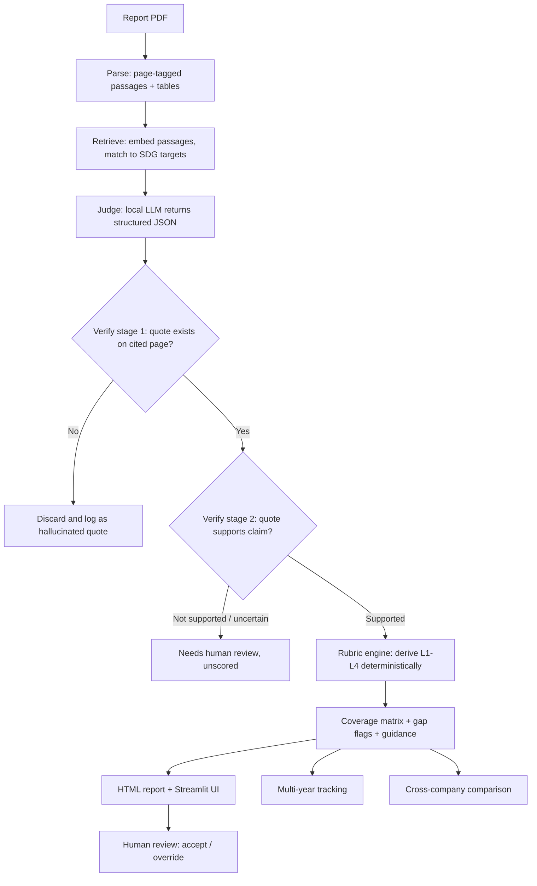

# Prism17: Evidence-Grounded SDG Disclosure Auditor

**THREWS ODYSSEY 2026 | Track: ClimateTech & Sustainability**

> **Status: working prototype, evaluation in progress.** The full pipeline, review interface, multi-year tracking, cross-company comparison and benchmark tooling are built and unit-tested. Evaluation on a human-labelled benchmark has not been run yet. **Nothing in this README reports a measured accuracy result, because none exists yet.**

Prism17 reads corporate sustainability disclosures (BRSR filings, sustainability reports, annual reports) and produces an **SDG Alignment Report**, similar to a similarity report attached to a document. It maps passages to the UN Sustainable Development Goals and their targets, grades how concrete each commitment is, and ties every finding to a **verified quote and page number**.

---

## Table of contents
1. [Project details](#1-project-details)
2. [Problem statement](#2-problem-statement)
3. [Proposed solution and key features](#3-proposed-solution-and-key-features)
4. [How it differs from existing approaches](#4-how-it-differs-from-existing-approaches)
5. [Technical plan and data flow](#5-technical-plan-and-data-flow)
6. [Technology stack](#6-technology-stack)
7. [SDGs targeted and impact](#7-sdgs-targeted-and-impact)
8. [Implementation overview](#8-implementation-overview)
9. [Datasets and external resources](#9-datasets-and-external-resources)
10. [Evaluation plan and results](#10-evaluation-plan-and-results)
11. [Progress and roadmap](#11-progress-and-roadmap)
12. [Running the project](#12-running-the-project)
13. [Responsible use and limitations](#13-responsible-use-and-limitations)
14. [AI assistance disclosure](#14-ai-assistance-disclosure)
15. [Team and acknowledgements](#15-team-and-acknowledgements)

---

## 1. Project details

| | |
|---|---|
| **Project name** | Prism17 |
| **Tagline** | Every SDG finding traced to a verified quote |
| **Hackathon** | THREWS ODYSSEY 2026 (Threws, The Research World) |
| **Track** | ClimateTech & Sustainability |
| **Theme fit** | Corporate sustainability reporting, ESG transparency and accountability |
| **Focus SDGs** | 8, 12, 13, 17 (all 17 supported in the tool) |
| **Status** | Working prototype, evaluation in progress |
| **Repository** | <https://github.com/HiXT0/Prism17> |
| **Demo** | Coming soon |
| **Demo video** | Coming soon |

## 2. Problem statement

Companies publish sustainability disclosures that run to hundreds of pages. SDG-related claims are scattered across narrative text and data tables, vary widely in specificity, and are hard to compare across companies or years. In India, BRSR filings are mandatory for the top listed companies, yet they are still difficult to screen at scale.

Existing SDG classifiers label text with goals. They do not answer what stakeholders actually ask:

- **How concrete is this commitment?** Is there a measurable indicator, a deadline, a baseline, reported progress?
- **Is the cited evidence real,** and does it support the claim being made?
- **How did a target change** between reporting years?

Investors, regulators, journalists and NGOs end up either reading manually or trusting automated output they cannot verify.

## 3. Proposed solution and key features

Prism17 takes a report PDF and returns an auditable report.

1. **Verified evidence.** Every quote is matched against the parsed source page, and quotes that cannot be found are discarded. A second check (Stage 2, off by default) tests whether the quote supports the claim, preserving negation, year, units and commitment status. Findings judged "not supported" or "uncertain" are left unscored.
2. **Rubric-based Commitment Quality Score.** Five dimensions are checked: specificity, measurable indicator, deadline, baseline and reported progress. A fixed rule then derives a level:

   | Level | Meaning |
   |---|---|
   | L1 | Aspiration only (no measurable indicator, deadline or baseline) |
   | L2 | Concrete action, but not fully quantified |
   | L3 | Quantified target with indicator, baseline and deadline |
   | L4 | L3 plus reported progress against the target |

   The level is derived by deterministic code, not by an LLM's opinion, so it is reproducible and unit-tested.
3. **Evidence Coverage Matrix.** For each SDG target or claim, shows which rubric dimensions are present, absent or not assessable, with neutral flags such as "disclosure gap" and "low specificity". Included in the Markdown report, HTML report and UI.
4. **Improvement guidance.** For each finding below L4, states what a disclosure would need to add to reach the next level.
5. **Multi-year tracking (narrow scope).** For quantified targets only (L3 and above by default, configurable with `--min-level`), reports progressing, unchanged, changed or not comparable (when baselines or units differ). Units are compared conservatively: kilotonnes are not collapsed into tonnes, and multipliers such as "million" are respected. It never concludes that a target was "discontinued", only "not found in later report (needs review)".
6. **Cross-company comparison.** A descriptive view of disclosure quality for a chosen SDG, with a configurable high-level threshold. It is not a ranking.
7. **Human oversight.** Low-confidence findings are left unscored, and a reviewer can accept or override any finding in the UI.
8. **Benchmark tooling.** Scripts generate an annotation template for human reviewers and score their labels against the model, reporting agreement and Cohen's kappa. With blank or invalid labels they report an explicit status and null metrics rather than placeholder numbers.

## 4. How it differs from existing approaches

SDG text classifiers (for example those trained on the OSDG Community Dataset) assign goal labels to text. Prism17 is intended to add:

- evidence that is verified against the source page, with a support check,
- commitment quality graded by transparent rules over five dimensions,
- disclosure gaps and multi-year changes reported in neutral language, and
- a design that runs entirely on local open models.

*A related-work comparison with citations will be added as the evaluation completes.*

## 5. Technical plan and data flow



**Stage by stage**

1. **Parse.** Text is extracted per page, split into passages (about 50 to 250 words) with page number and section heading, and tables are extracted separately. Unreadable pages are logged and reported, never silently skipped.
2. **Retrieve.** SDG target texts and passages are embedded, and the top candidate targets per passage above a tuned score threshold are kept.
3. **Judge.** A local LLM returns strict JSON: claim, exact supporting quote, the five rubric dimensions, extracted value, unit, year, status, negation flag and confidence. Malformed output is retried once, then marked for human review. Calls are cached.
4. **Verify.** Stage 1 string-matches the quote on the cited page. Stage 2 checks semantic support with a deterministic consistency guard plus an optional NLI or LLM check.
5. **Score.** Levels are derived by fixed rules (see [Section 3](#3-proposed-solution-and-key-features)).
6. **Report.** Coverage matrix, gap flags, guidance and a self-contained HTML report with highlighted evidence and page links.
7. **Track and compare.** Quantified targets are matched across years, and companies are compared per SDG.

## 6. Technology stack

| Layer | Tools |
|---|---|
| Language | Python 3.11+ |
| PDF parsing | PyMuPDF (page text), pdfplumber (tables) |
| Retrieval | sentence-transformers (BAAI/bge-small-en-v1.5), FAISS (CPU) |
| LLM judgement | Ollama running open-weight models locally (default Qwen 2.5 7B Instruct; Llama 3.1 8B and Gemma 2 9B for comparison) |
| Verification | rapidfuzz string matching, plus an NLI or LLM entailment check |
| Rubric engine | Deterministic rules |
| Reports and UI | Jinja2 (HTML reports), Streamlit |
| Evaluation | pandas, scikit-learn metrics, Cohen's kappa, pytest, codecarbon (energy estimate) |

**Design principle:** everything runs locally on a laptop with no GPU and no paid or proprietary AI APIs. Reports never leave the user's machine, and the tool's own footprint stays small.

## 7. SDGs targeted and impact

Prism17 supports accountability and transparency in corporate reporting. It does not itself change company behaviour, and its contribution is making disclosures comparable, checkable and easier to improve.

| SDG | How Prism17 relates |
|---|---|
| **SDG 12** Responsible Consumption and Production | Makes sustainable-practice and reporting commitments (including target 12.6 on corporate sustainability reporting) easier to screen and compare |
| **SDG 13** Climate Action | Grades the specificity of climate targets (emissions, baselines, deadlines, progress) |
| **SDG 8** Decent Work and Economic Growth | Surfaces workforce and labour-related disclosures and their specificity |
| **SDG 17** Partnerships for the Goals | Supports data and accountability partnerships by producing open, auditable, comparable outputs |

**Who benefits:** investors and analysts screening reports, regulators checking disclosure quality, journalists and NGOs needing traceable evidence, and companies wanting concrete guidance on strengthening their reporting.

**Scalability:** more report types and languages can be added, and the local small-model design keeps cost and energy use low.

## 8. Implementation overview

```
prism17/
  prism17/
    parse.py        PDF -> page-tagged passages
    retrieve.py     embeddings + FAISS target matching
    judge.py        LLM rubric extraction (structured JSON)
    verify.py       quote verification (stage 1)
    semantic.py     semantic-support check (stage 2)
    rubric.py       deterministic L1-L4 derivation
    coverage.py     evidence coverage matrix + gap flags
    guidance.py     "what to add to reach the next level"
    review.py       human-review decisions
    report.py       Markdown and HTML report generation
    tracking.py     multi-year tracking for quantified targets
    compare.py      cross-company comparison
    evaluation.py   agreement metrics, threshold selection, provenance
    benchmark.py    gold-set annotation templates and scoring
    pipeline.py     orchestration and CLI
    ui.py           Streamlit UI components
  app.py            Streamlit entry point
  eval/             OSDG sanity check, gold template and benchmark scoring scripts
  prompts/          judge system prompt and examples
  data/             SDG targets, annotation guidelines, manifests (reports not redistributed)
  docs/             rubric definition and calibration notes
  tests/            unit tests
```

## 9. Datasets and external resources

| Resource | Use | Notes |
|---|---|---|
| **UN SDG targets and indicators** | Reference text for retrieval | Official UN framework |
| **OSDG Community Dataset (OSDG-CD), v2024.04** | Sanity check of the SDG-relevance step and retrieval threshold only | <https://zenodo.org/records/11441197>, licence CC-BY-4.0 per the dataset record. Cite the original release, DOI 10.5281/zenodo.5550238. SDG labels only, so it cannot test rubric levels or verification |
| **Corporate BRSR and sustainability reports** | Inputs and benchmark | Public reports, recorded in `data/manifest.csv` with source links once finalised. PDFs are not redistributed |
| **Self-built gold set** | Evaluation of mapping, rubric and verification | In preparation: two independent annotators with adjudication. Guidelines are in `data/gold/ANNOTATION_GUIDELINES.md` |
| **Open models and libraries** | See Section 6 | Used under their respective licences. Llama and Gemma are open-weight with their own licence terms |

No DEV or test report is used to tune prompts or thresholds. Threshold suggestions come from OSDG data only.

## 10. Evaluation plan and results

**Plan**

- Benchmark of reports across multiple companies and years (final number to be fixed), with a split by company into dev and held-out test.
- Passages annotated independently by two annotators for SDG relevance, target mapping and rubric dimensions, with disagreements adjudicated.
- Metrics: SDG-mapping precision, recall and F1; Cohen's kappa for annotators and for system-versus-human rubric agreement; quote-verification pass rate; hallucination rate before filtering; semantic-support check accuracy.
- Baselines and ablations: keyword matching, pipeline without verification, pipeline without the rubric.
- Model comparison with runtime and energy per report, plus error analysis of failure cases.

**Results**

| Item | Status |
|---|---|
| Unit tests | 244 passed at the last full run; a few later edits to tracking unit parsing were made after that run |
| OSDG relevance sanity check | Script built, smoke-tested without the judge. Full run pending (dataset not yet downloaded) |
| Stage 2 semantic check | Implemented. Deterministic guard is tested. NLI model not yet validated end to end |
| Benchmark tooling | Template generator and scorer work. Blank or invalid labels give explicit statuses and null metrics |
| Gold-set benchmark | No human annotations exist yet |
| Final metrics | **Not yet available. To be added only once measured** |

## 11. Progress and roadmap

- [x] Project scaffold, config, SDG target data
- [x] PDF parsing into page-tagged passages
- [x] Retrieval and local LLM judge with caching and retry
- [x] Quote verification (stage 1) and deterministic rubric with tests
- [x] HTML report, coverage matrix and improvement guidance
- [x] Streamlit interface with human-review controls (being verified on real reports)
- [x] OSDG sanity-check script and evaluation helpers
- [x] Semantic-support check (stage 2) implemented, off by default (not yet validated end to end)
- [x] Multi-year tracking for quantified targets
- [x] Cross-company comparison view
- [x] Benchmark annotation guidelines, template generator and scoring script
- [ ] Full OSDG sanity-check run and retrieval-threshold selection
- [ ] Human-annotated gold set (dev, then held-out test)
- [ ] Evaluation run, baselines, ablations and error analysis
- [ ] Live demo and demo video

## 12. Running the project

```bash
# 1. Install Ollama and pull a model
ollama pull qwen2.5:7b-instruct

# 2. Install dependencies
python -m venv .venv
.venv\Scripts\activate          # Windows (use: source .venv/bin/activate on Linux/macOS)
pip install -r requirements.txt

# 3. Run the command-line pipeline on a report
python -m prism17.pipeline path/to/report.pdf
#    add --semantic to enable the stage 2 support check

# 4. Or launch the interface
streamlit run app.py

# 5. Multi-year tracking and cross-company comparison on audit JSON files
python -m prism17.tracking earlier.audit.json later.audit.json
python -m prism17.compare a.audit.json b.audit.json --labels "Company A" "Company B"

# 6. Benchmark tooling (annotation template, then scoring)
python eval/make_gold_template.py earlier.audit.json later.audit.json --out template.csv
python eval/score_benchmark.py template.csv --out eval/benchmark.json

# 7. Run tests
python -m pytest -q
```

Run `--help` on each command for the full option list (for example `--min-level`, `--sdg`, `--out`).

## 13. Responsible use and limitations

- Prism17 assesses the **quality of disclosure**, not real-world sustainability performance, and cannot verify that a claim is true.
- It never labels a company as misleading or irresponsible. Flags use neutral wording such as "disclosure gap".
- Low-confidence findings are left unscored and routed to a human reviewer, who can override any finding. Review decisions annotate the report and do not change the rubric level.
- The rubric measures specificity, which is a proxy and not proof of credibility.
- Accuracy drops on scanned or poorly formatted PDFs and complex tables, and small open models can miss nuance in long passages.
- Multi-year tracking covers quantified disclosure only. It does not match reworded indicators, adjust for restatements, or establish a trend. A target missing from a later report may have moved to another section or not been retrieved.
- Cross-company comparison is descriptive. It does not normalise for report length, sector or retrieval settings and must not be used as a ranking.
- No accuracy figures are claimed until they are measured on a human-annotated benchmark.
- The rubric, prompts and evaluation results will be published for audit.

## 14. AI assistance disclosure

AI coding and research assistants were used during the development of this project, as permitted by the hackathon rules. The team is responsible for the submitted work and will be able to explain it during evaluation.

Claude, Gemini and ChatGPT were used for research and literature review. A manual Google Scholar search was then carried out to validate the findings. For small code snippets and function writing, Claude Code and OpenCode were used.

Separately, Prism17 itself uses open-weight language models at runtime, as described in Section 6.

## 15. Team and acknowledgements

**Team:** Prateek Kumar and Pritam Bhakta (Students), Dr Pushan Kumar Dutta (Faculty Guide and Researcher), Amity University Kolkata

**Acknowledgements:** UN Statistics Division (SDG framework), the OSDG project and its community (OSDG Community Dataset), and the open-source authors of Ollama, PyMuPDF, pdfplumber, sentence-transformers, FAISS, rapidfuzz, Streamlit, Jinja2, pandas and scikit-learn. Model weights (Qwen, Llama, Gemma) are used under their respective licences.

**Pre-existing work:** The project was built during the hackathon period. It reuses only the open-source libraries, public datasets and open-weight models listed above.

---

*This repository documents work in progress for THREWS ODYSSEY 2026.*
