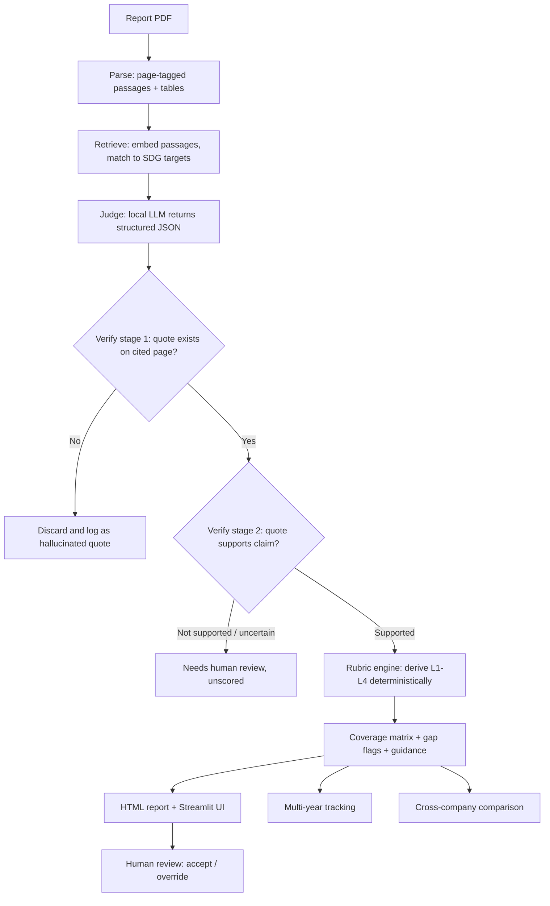

# Prism17: Evidence-Grounded SDG Disclosure Auditor

**THREWS ODYSSEY 2026 | Track: ClimateTech & Sustainability**

> **Status: under active development.** The core pipeline and interface are built and being verified. Evaluation on a labelled benchmark is in progress. A live demo and final results will be added here soon. Nothing in this README reports a measured result unless it is marked as such.

Prism17 reads corporate sustainability disclosures (BRSR filings, sustainability reports, annual reports) and produces an **SDG Alignment Report**, similar to a similarity report attached to a document. It maps passages to the UN Sustainable Development Goals and their targets, grades how concrete each commitment is, and ties every finding to a **verified quote and page number**.

---

## Table of contents
1. [Project details](#1-project-details)
2. [Problem statement](#2-problem-statement)
3. [Proposed solution and key features](#3-proposed-solution-and-key-features)
4. [How it differs from existing approaches](#4-how-it-differs-from-existing-approaches)
5. [Technical plan and data flow](#5-technical-plan-and-data-flow)
6. [Technology stack](#6-technology-stack)
7. [SDGs targeted and impact](#7-sdgs-targeted-and-impact)
8. [Implementation overview](#8-implementation-overview)
9. [Datasets and external resources](#9-datasets-and-external-resources)
10. [Evaluation plan and results](#10-evaluation-plan-and-results)
11. [Progress and roadmap](#11-progress-and-roadmap)
12. [Running the project](#12-running-the-project)
13. [Responsible use and limitations](#13-responsible-use-and-limitations)
14. [AI assistance disclosure](#14-ai-assistance-disclosure)
15. [Team and acknowledgements](#15-team-and-acknowledgements)

---

## 1. Project details

| | |
|---|---|
| **Project name** | Prism17 |
| **Tagline** | Every SDG finding traced to a verified quote |
| **Hackathon** | THREWS ODYSSEY 2026 (Threws, The Research World) |
| **Track** | ClimateTech & Sustainability |
| **Focus SDGs** | 8, 12, 13, 17 (all 17 supported in the tool) |
| **Status** | Under development, live demo coming soon |
| **Repository** | this repository |
| **Demo** | *[link to be added]* |
| **Demo video** | *[link to be added]* |

## 2. Problem statement

Companies publish sustainability disclosures that run to hundreds of pages. SDG-related claims are scattered across narrative text and data tables, vary widely in specificity, and are hard to compare across companies or years. In India, BRSR filings are mandatory for the top listed companies, yet they are still difficult to screen at scale.

Existing SDG classifiers label text with goals. They do not answer what stakeholders actually ask:

- **How concrete is this commitment?** Is there a measurable indicator, a deadline, a baseline, reported progress?
- **Is the cited evidence real,** and does it support the claim being made?
- **How did a target change** between reporting years?

Investors, regulators, journalists and NGOs end up either reading manually or trusting automated output they cannot verify.

## 3. Proposed solution and key features

Prism17 takes a report PDF and returns an auditable report.

1. **Verified evidence.** Every quote is matched against the parsed source page, and quotes that cannot be found are discarded. A second check tests whether the quote supports the claim, preserving negation, year, units and commitment status.
2. **Rubric-based Commitment Quality Score.** Five dimensions are checked: specificity, measurable indicator, deadline, baseline and reported progress. A fixed rule then derives a level:

   | Level | Meaning |
   |---|---|
   | L1 | Aspiration only (no measurable indicator, deadline or baseline) |
   | L2 | Concrete action, but not fully quantified |
   | L3 | Quantified target with indicator, baseline and deadline |
   | L4 | L3 plus reported progress against the target |

   The level is derived by deterministic code, not by an LLM's opinion, so it is reproducible and unit-tested.
3. **Evidence Coverage Matrix.** For each SDG target or claim, shows which rubric dimensions are present, absent or not assessable, with neutral flags such as "disclosure gap" and "low specificity".
4. **Improvement guidance.** For each finding below L4, states what a disclosure would need to add to reach the next level.
5. **Multi-year tracking (narrow scope).** For quantified targets only, reports progressing, unchanged, changed or not comparable (when baselines or units differ). It never concludes that a target was "discontinued", only "not found in later report (needs review)".
6. **Cross-company comparison** on disclosure quality for a chosen SDG.
7. **Human oversight.** Low-confidence findings are left unscored, and a reviewer can accept or override any finding in the UI.

## 4. How it differs from existing approaches

SDG text classifiers (for example those trained on the OSDG Community Dataset) assign goal labels to text. Prism17 is intended to add:

- evidence that is verified against the source page, with a support check,
- commitment quality graded by transparent rules over five dimensions,
- disclosure gaps and multi-year changes reported in neutral language, and
- a design that runs entirely on local open models.

*A related-work comparison with citations will be added as the evaluation completes.*

## 5. Technical plan and data flow



**Stage by stage**

1. **Parse.** Text is extracted per page, split into passages (about 50 to 250 words) with page number and section heading, and tables are extracted separately. Unreadable pages are logged and reported, never silently skipped.
2. **Retrieve.** SDG target texts and passages are embedded, and the top candidate targets per passage above a tuned score threshold are kept.
3. **Judge.** A local LLM returns strict JSON: claim, exact supporting quote, the five rubric dimensions, extracted value, unit, year, status, negation flag and confidence. Malformed output is retried once, then marked for human review. Calls are cached.
4. **Verify.** Stage 1 string-matches the quote on the cited page. Stage 2 checks semantic support.
5. **Score.** Levels are derived by fixed rules (see [Section 3](#3-proposed-solution-and-key-features)).
6. **Report.** Coverage matrix, gap flags, guidance and a self-contained HTML report with highlighted evidence and page links.
7. **Track and compare.** Quantified targets are matched across years, and companies are compared per SDG.

## 6. Technology stack

| Layer | Tools |
|---|---|
| Language | Python 3.11+ |
| PDF parsing | PyMuPDF (page text), pdfplumber (tables) |
| Retrieval | sentence-transformers (BAAI/bge-small-en-v1.5), FAISS (CPU) |
| LLM judgement | Ollama running open-weight models locally (default Qwen 2.5 7B Instruct; Llama 3.1 8B and Gemma 2 9B for comparison) |
| Verification | rapidfuzz string matching, plus an NLI or LLM entailment check |
| Rubric engine | Deterministic rules |
| Reports and UI | Jinja2 (HTML reports), Streamlit |
| Evaluation | pandas, scikit-learn metrics, Cohen's kappa, pytest, codecarbon (energy estimate) |

**Design principle:** everything runs locally on a laptop with no GPU and no paid or proprietary AI APIs. Reports never leave the user's machine, and the tool's own footprint stays small.

## 7. SDGs targeted and impact

Prism17 supports accountability and transparency in corporate reporting. It does not itself change company behaviour, and its contribution is making disclosures comparable, checkable and easier to improve.

| SDG | How Prism17 relates |
|---|---|
| **SDG 12** Responsible Consumption and Production | Makes sustainable-practice and reporting commitments (including target 12.6 on corporate sustainability reporting) easier to screen and compare |
| **SDG 13** Climate Action | Grades the specificity of climate targets (emissions, baselines, deadlines, progress) |
| **SDG 8** Decent Work and Economic Growth | Surfaces workforce and labour-related disclosures and their specificity |
| **SDG 17** Partnerships for the Goals | Supports data and accountability partnerships by producing open, auditable, comparable outputs |

**Who benefits:** investors and analysts screening reports, regulators checking disclosure quality, journalists and NGOs needing traceable evidence, and companies wanting concrete guidance on strengthening their reporting.

**Scalability:** more report types and languages can be added, and the local small-model design keeps cost and energy use low.

## 8. Implementation overview

```
prism17/
  prism17/
    parse.py        PDF -> page-tagged passages
    retrieve.py     embeddings + FAISS target matching
    judge.py        LLM rubric extraction (structured JSON)
    verify.py       quote verification (stage 2 in progress)
    rubric.py       deterministic L1-L4 derivation
    coverage.py     evidence coverage matrix + gap flags
    guidance.py     "what to add to reach the next level"
    report.py       HTML report generation
    evaluation.py   metrics, threshold selection, provenance
    pipeline.py     orchestration and CLI
  app.py            Streamlit UI with human-review controls
  eval/             evaluation scripts (OSDG sanity check, benchmark tooling)
  data/             reference data and manifests (reports not redistributed)
  tests/            unit tests
```

## 9. Datasets and external resources

| Resource | Use | Notes |
|---|---|---|
| **UN SDG targets and indicators** | Reference text for retrieval | Official UN framework |
| **OSDG Community Dataset (OSDG-CD), v2024.04** | Sanity check of the SDG-relevance step and retrieval threshold only | <https://zenodo.org/records/11441197>, licence CC-BY-4.0 per the dataset record. Cite the original release, DOI 10.5281/zenodo.5550238. SDG labels only, so it cannot test rubric levels or verification |
| **Corporate BRSR and sustainability reports** | Inputs and benchmark | Public reports from *[companies to be listed]*, recorded in `data/manifest.csv` with source links. PDFs are not redistributed |
| **Self-built gold set** | Evaluation of mapping, rubric and verification | In preparation: two independent annotators with adjudication. Guidelines will be published |
| **Open models and libraries** | See Section 6 | Used under their respective licences. Llama and Gemma are open-weight with their own licence terms |

No DEV or test report is used to tune prompts or thresholds. Threshold suggestions come from OSDG data only.

## 10. Evaluation plan and results

**Plan**

- Benchmark of *[N]* reports across multiple companies and years, with a split by company into dev and held-out test.
- About *[150 to 200]* passages annotated independently by two annotators for SDG relevance, target mapping and rubric dimensions, with disagreements adjudicated.
- Metrics: SDG-mapping precision, recall and F1; Cohen's kappa for annotators and for system-versus-human rubric agreement; quote-verification pass rate; hallucination rate before filtering; semantic-support check accuracy.
- Baselines and ablations: keyword matching, pipeline without verification, pipeline without the rubric.
- Model comparison with runtime and energy per report, plus error analysis of failure cases.

**Results**

| Item | Status |
|---|---|
| Unit tests (rubric, metrics, retrieval, judge) | Passing at last run |
| OSDG relevance sanity check | Script built, smoke-tested without the judge. Full run pending |
| Gold-set benchmark | Annotation in preparation |
| Final metrics | **Not yet available. To be added only once measured** |

## 11. Progress and roadmap

- [x] Project scaffold, config, SDG target data
- [x] PDF parsing into page-tagged passages
- [x] Retrieval and local LLM judge with caching and retry
- [x] Quote verification (stage 1) and deterministic rubric with tests
- [x] HTML report, coverage matrix and improvement guidance
- [x] Streamlit interface with human-review controls (being verified on real reports)
- [x] OSDG sanity-check script and evaluation helpers
- [ ] Full OSDG sanity-check run and retrieval-threshold selection
- [ ] Semantic-support check (verification stage 2)
- [ ] Benchmark annotation guidelines and gold set (dev, then held-out test)
- [ ] Evaluation run, baselines, ablations and error analysis
- [ ] Multi-year tracking for quantified targets
- [ ] Cross-company comparison view
- [ ] Documentation, demo video and live demo

## 12. Running the project

*Setup is documented as the project stabilises. Expected steps:*

```bash
# 1. Install Ollama and pull a model
ollama pull qwen2.5:7b-instruct

# 2. Install dependencies
python -m venv .venv
pip install -r requirements.txt

# 3. Run the command-line pipeline on a report
python -m prism17.pipeline path/to/report.pdf

# 4. Or launch the interface
streamlit run app.py

# 5. Run tests
python -m pytest -q
```

## 13. Responsible use and limitations

- Prism17 assesses the **quality of disclosure**, not real-world sustainability performance, and cannot verify that a claim is true.
- It never labels a company as misleading or irresponsible. Flags use neutral wording such as "disclosure gap".
- Low-confidence findings are left unscored and routed to a human reviewer, who can override any finding.
- The rubric measures specificity, which is a proxy and not proof of credibility.
- Accuracy drops on scanned or poorly formatted PDFs and complex tables, and small open models can miss nuance in long passages.
- Multi-year tracking covers quantified targets only and marks uncertain matches as not comparable.
- The rubric, prompts and evaluation results will be published for audit.

## 14. AI assistance disclosure

AI coding and research assistants were used during the development of this project, as permitted by the hackathon rules. The team is responsible for the submitted work and will be able to explain it during evaluation.

Claude, Gemini, Chatgpt has been used for research and literature review after that a manual google scholor search has been done and validated the work. FOr small code snippets and function writting clause code and opencode has been used.

Separately, Prism17 itself uses open-weight language models at runtime, as described in Section 6.

## 15. Team and acknowledgements

**Team:** *Prateek Kumar & Pritam Bhakta (Student), Dr Pushan Kumar Dutta (Faculty Guide and Researcher), Amity University Kolkata*

**Acknowledgements:** UN Statistics Division (SDG framework), the OSDG project and its community (OSDG Community Dataset), and the open-source authors of Ollama, PyMuPDF, pdfplumber, sentence-transformers, FAISS, rapidfuzz, Streamlit, Jinja2, pandas and scikit-learn. Model weights (Qwen, Llama, Gemma) are used under their respective licences.

**Pre-existing work:** *[State clearly what existed before the hackathon period, if anything, and what was built during it.]*

---

*This repository documents work in progress for THREWS ODYSSEY 2026.*
